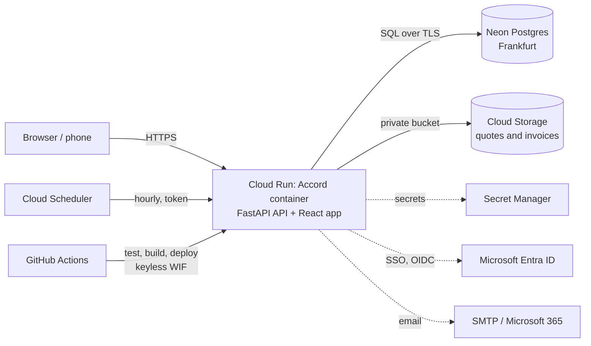

# Accord

**Agree the spend before it happens.** Accord is Orvane Group's spend approval system. Before anyone commits money they raise a request. It goes to the right approvers automatically, and Finance matches it to the invoice and payment. Everyone sees what they should, and every decision is on a tamper-evident record.

**Live demo:** https://accord-479375989955.europe-west3.run.app

## Using it as different people

The demo has a copy of Orvane: about 120 people across Dubai head office and sites in Accra, Lima and Johannesburg, with eight months of realistic history. There are no passwords in the demo. Pick a person on the sign-in page, and switch any time with **Switch person** in the green bar at the top. You can also search for anyone in the company.

In production there's no persona picker: people sign in with their normal Microsoft 365 account ([docs/SSO.md](docs/SSO.md)).

| Sign in as | To see |
| --- | --- |
| **Nadia Frost**, COO | Her approvals inbox, with why each request needs her (manager, COO, or both), the company-wide picture, and who covers for her while she travels |
| **Tom Becker**, Head of Finance | Approved, invoiced and paid spend, and who owns the next step when an invoice is above its approval. He owns the approval rules, categories and exchange rates, and can export for the auditors |
| **Priya Nair**, reports to Nadia | Start an IT request: **Who will approve** shows Nadia **once**, although she's both Priya's manager and the COO |
| **Marco Silva**, covering for Hannah | Hannah's approvals come to him while she's away. His own requests still go to her |
| **Thabo Nkosi**, site manager | His generator quote went up after approval (ZAR 85k → 140k). Approvers see both amounts before they decide, and the original approval stands until they do |
| **Leo Park**, systems engineer | The Dell laptops were approved at $7,200 and invoiced at $7,950. Accord asks him to review the difference and submit the revised total |
| **Ama Owusu**, site procurement | Raises requests in Ghana cedi. Approvers can send a request back for changes instead of rejecting it |
| **Sara Lindqvist**, accounts payable | Records invoices and releases payments. She queries wrong invoices with the supplier and records the corrected ones. She can't pay her own requests |
| **Daniel Reyes**, Technology Lead | Administrator: people, managers, roles, leavers |
| **Grace Liu**, internal audit | Read-only access to everything, plus the audit log and integrity check |

The **Email outbox** (Settings & records, demo only) shows every email Accord sent. You can also run the reminder job on demand there, or reset the demo.

## A ten-minute tour of what was asked for

| On the call | Where it is |
| --- | --- |
| "Before anybody spends anything they put it in, and it gets approved" | **New request.** While you type, the side panel shows who will approve and why |
| Line manager, then Nadia if it's big, and IT always | Approval rules (**Settings → Approval rules**): line manager always, COO for all IT, COO from USD 5,000, travel from USD 3,000 |
| "Keep it flexible because it will change" | Finance edits the rules in the app, tries them out against an example, and publishes a new version. Requests keep the version that routed them |
| Priya: "it comes to me, and then it comes to me again?" | The same person never gets two steps. Nobody approves their own request: it goes up to their manager |
| Tom needs to see what's approved, paid and unpaid | **Finance**: approved with no invoice, invoiced but unpaid, and paid. CSV export |
| An invoice that doesn't match the approval | **Finance → Invoice differences**: how much over, who owns the next step and what it is. The requester submits the revised total, the approver decides it, or Finance queries the supplier and records a corrected invoice |
| Attach the quote, but not always (visa fees) | A quote is required unless the requester says why there isn't one. Categories like visas don't need one |
| What's waiting for me, plus the whole picture | **Home** and **Insights**: by department, category, site, project, supplier and month |
| Everyone sees their own, heads see theirs, some things are sensitive | Visibility rules below. Confidential requests only show to the people involved |
| Spend per project and per trip | **Projects & trips**: the total cost of the new finance system ($270k against a $250k budget) and of the Mining Indaba trip, across people and currencies |
| Categories from Tom | Placeholder list under **Settings → Categories**, editable when his list arrives |
| Notifications they can't say they didn't see | Email and in-app notifications, daily reminders, and a record of when the approver first opened the request |
| No new password | Microsoft Entra ID single sign-on (OpenID Connect) |
| On the phone | Mobile-first design. Approve or reject from the request page in two taps. Installable to the home screen |
| "When I'm away it can't all just stop… not just anyone" | **Cover while away**: a stand-in for set dates, limited to approved people, recorded as "on behalf of" |
| Local currency at the sites | Requests in any currency, converted to USD at Finance's rate for limits and reporting |
| Auditors in January: who approved what and when | Append-only, hash-chained audit log, with an integrity check and CSV export. Each approval is tied to a fingerprint of exactly what was approved |
| Rejections need a reason | One tap on a reason (Finance's list), plus an optional note |
| "What if they change it after it's approved?" | **Change amount or details**: within 5% it's recorded and Finance is told. Above that it goes back for approval, and the original approval stands meanwhile. Approvers see "Approved ZAR 85,000 → Requested ZAR 140,000" in their queue |
| Recurring subscriptions and retainers | Approved once for the whole term and judged on the full contract value. A renewal reminder goes out before it ends |
| It needs a name | Accord |
| Reading invoices with AI | Not built yet. Requests carry a reference (AC-1234) that suppliers quote on invoices, which is what makes automatic matching reliable later |

The full list of assumptions and decisions is in [docs/DECISIONS.md](docs/DECISIONS.md).

## How the rules work

- **Routing.** The rules are checked top to bottom for each request. Each matching rule adds an approver: line manager, department head, a position (COO, CEO) or a named person. They can be limited to IT, travel or general spend, from a USD amount. Duplicates merge into one step. If an approver is the requester or has left, the step goes to their manager. If there's no one, it goes to the fallback approver.
- **Limits use the full commitment.** A $250/month three-year contract counts as $9,000. Local currency is converted at Finance's rate on the day.
- **Visibility.** Everyone sees their own requests and anything they approve. Managers see their whole reporting line, and department heads see their department. Executives, Finance, auditors and administrators see everything. Confidential requests are limited to the requester, the approvers and the see-everything roles. Drafts are private.
- **Separation of duties.** Nobody approves their own request. A stand-in can't approve their own requests, or add a second approval to a request they already approve. Finance can't pay their own requests. Administrators can't approve other people's requests.
- **After approval.** An approval is locked. Changes create a new version. Small changes are applied and Finance is told. Larger ones, or ones that need a new approver, go back through approval.
- **Invoices above the approval.** An invoice above the approved amount (plus tolerance) needs a note from Finance, and opens a difference that shows who owns the next step. The requester reviews it and submits the revised total through the same change flow. If the supplier billed wrongly, Finance queries the invoice (it can't be paid meanwhile) and records a corrected one, which replaces it. The original is kept as void. Paying with a difference still open isn't blocked yet: that's a policy question for the COO ([docs/DECISIONS.md](docs/DECISIONS.md#money)).

## Architecture



- **Backend:** Python 3.13, FastAPI, SQLAlchemy 2, Alembic, PostgreSQL. Domain logic is in plain modules: [policy.py](backend/app/policy.py) (rules engine), [workflow.py](backend/app/workflow.py) (every state change), [permissions.py](backend/app/permissions.py) and [audit.py](backend/app/audit.py).
- **Frontend:** React 19, TypeScript, Tailwind CSS, TanStack Query. It's built into the same container and served by the API.
- **Hosting:** Google Cloud Run in europe-west3, scaling to zero. Neon serverless Postgres in Frankfurt, a private and versioned Cloud Storage bucket, and Secret Manager for credentials. Free tiers only.
- **Security:** single sign-on with no local passwords. Opaque, revocable sessions are stored hashed. Cookies are HttpOnly, Secure and SameSite. API calls need a CSRF header, and the CSP, HSTS and frame-deny headers are set. Uploads are checked by type and file signature, stored privately and only served after a permission check. The runtime account has least privilege: it can add and read documents, but not delete them. CI/CD deploys with no stored cloud keys.
- **Audit:** every event stores the SHA-256 of the previous event, and a database trigger blocks UPDATE, DELETE and TRUNCATE on the log.

More detail is in [docs/OPERATIONS.md](docs/OPERATIONS.md).

## Running locally

You need Docker, [uv](https://docs.astral.sh/uv/) and Node 22+.

```bash
docker run -d --name accord-db -p 5433:5432 -e POSTGRES_USER=accord -e POSTGRES_PASSWORD=accord -e POSTGRES_DB=accord \
  -v "$PWD/backend/scripts/init-test-db.sql:/docker-entrypoint-initdb.d/init.sql:ro" postgres:17-alpine

cd backend
uv sync
uv run python -m app.seed --reset                  # demo organisation and history
ACCORD_DEMO_MODE=true ACCORD_COOKIE_SECURE=false uv run uvicorn app.main:app --reload --port 8000

cd ../frontend
npm ci && npm run dev                             # http://localhost:5173 (proxies /api to :8000)
```

Tests run against a real Postgres (the `accord_test` database):

```bash
cd backend && uv run pytest        # 65 tests: routing, workflow, delegation, finance, leavers, visibility, audit, API
cd frontend && npx tsc -b && npx oxlint src && npm run build
```

`docker compose --profile app up --build` runs the whole thing in containers on http://localhost:8080.

## Deploying

Each push to `main` runs the tests, builds the image, deploys it to Cloud Run and smoke-tests it ([.github/workflows/ci.yml](.github/workflows/ci.yml)). The one-time cloud setup is a reviewable, re-runnable script: [infra/gcp-setup.sh](infra/gcp-setup.sh).

## Repository layout

```
backend/   FastAPI app (app/), migrations (alembic/), tests (tests/)
frontend/  React app (src/pages, src/components)
infra/     Google Cloud setup script
docs/      Decisions, SSO setup for IT, operations runbook
```
